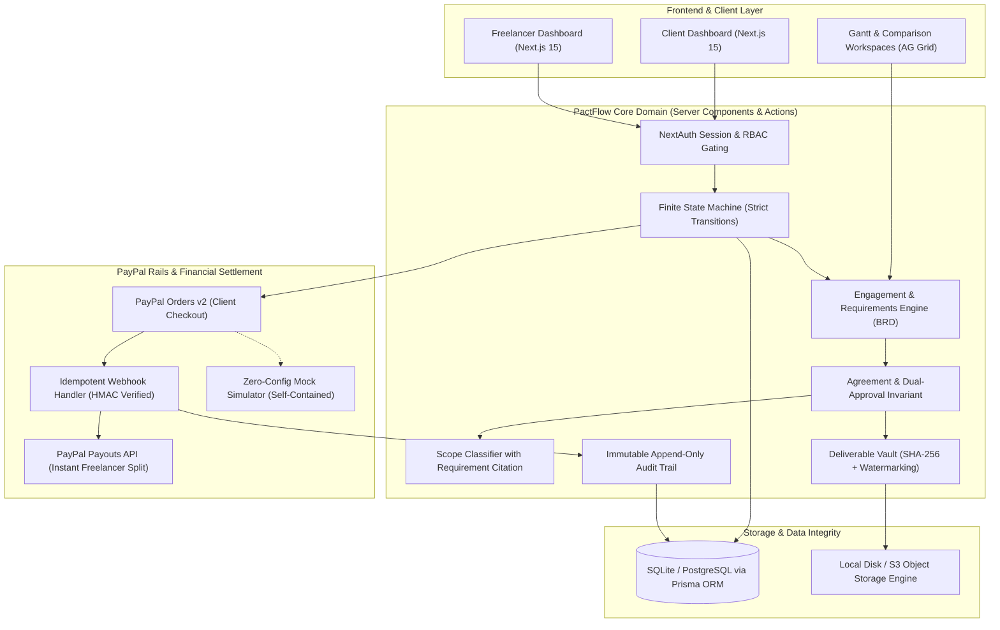
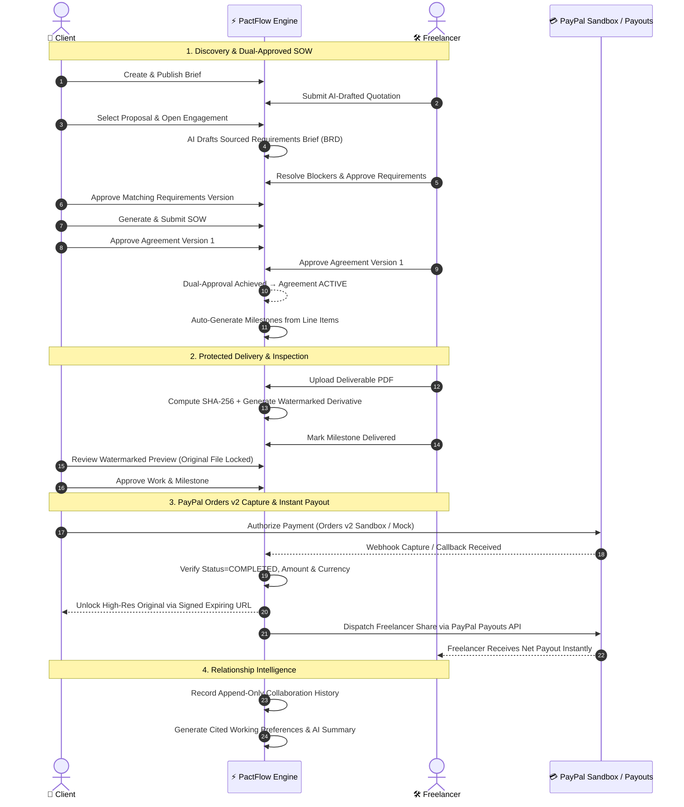

# PactFlow

<div align="center">

**Trust-First Freelance Collaboration & Payment Platform**

*Agree in writing. Deliver on proof. Pay with PayPal. Remember what worked.*

[](https://nextjs.org/)
[](https://www.typescriptlang.org/)
[](https://developer.paypal.com)
[](https://www.prisma.io/)
[](https://tailwindcss.com/)
[](https://vitest.dev/)

</div>

---

## 📌 Executive Summary

Freelance engagements consistently fail at three high-friction moments:
1. **Unclear Scope & Moving Goalposts**: Handshake deals and chat threads cause scope creep and unpaid labor.
2. **Delivery & Payment Hostage Standoffs**: Clients fear paying before seeing work; Freelancers fear sending unprotected deliverables without payment.
3. **Fragmented Payouts**: Manual billing, delayed disbursements, and opaque platform deductions.

**PactFlow** solves this with a **verifiable, milestone-driven protocol**:
- **Dual-Approved SOW & Scope Baseline**: Every agreement requires mutual, immutable cryptographic approval. AI parses requirements, tracks provenance, and cites exact IDs for out-of-scope changes.
- **Cryptographic Deliverable Vault**: Deliverables are uploaded with SHA-256 hashes and watermarked derivatives. The original high-resolution file unlocks **only** after PayPal confirms payment capture.
- **Automated Two-Sided PayPal Rails**: Client pays each milestone via **PayPal Orders v2**; upon verified capture, PactFlow automatically calculates platform fees and distributes the net balance to the freelancer via the **PayPal Payouts API**.
- **Append-Only Collaboration History**: Completed projects yield cited AI performance summaries and reusable project templates.

---

## 🏗️ System Architecture



---

## 🔄 End-to-End Lifecycle Sequence



---

## 💻 Tech Stack Matrix

| Domain | Technology | Purpose & Implementation |
|---|---|---|
| **Framework** | **Next.js 15 (App Router)** | React Server Components for zero-leak data rendering; Server Actions for atomic mutations. |
| **Language** | **TypeScript 5 (Strict)** | End-to-end type safety, strict null checks, and Zod schemas across every API boundary. |
| **Styling & UI** | **Tailwind CSS + Headless UI** | Accessible, responsive design system with role-aware status badges and progress trackers. |
| **Grid & Charts** | **AG Grid Community** | High-performance, pinned-column quotation comparison grid with client-side export. |
| **ORM & Database** | **Prisma + SQLite / PostgreSQL** | Multi-table relational integrity with ACID transactional boundaries and idempotent seeding. |
| **Payment Rails** | **PayPal Orders v2 API** | Secure client checkout authorization, capture reconciliation, and failure fallback. |
| **Disbursements** | **PayPal Payouts API** | Automated batch payouts transferring net balances directly to freelancer PayPal accounts. |
| **Payment Testing**| **PayPal Sandbox + Local Mock** | Supports live PayPal Sandbox credentials or an in-process Orders v2 mock simulator. |
| **Deliverable Vault**| **pdf-lib + Node Crypto** | Cryptographic SHA-256 byte hashing, server-side watermark stamping, and signed expiring URLs. |
| **Intelligence** | **Deterministic / LLM Hybrid**| AI requirement synthesis citing source message and proposal IDs; deterministic heuristic fallback. |
| **Testing** | **Vitest + Fast-Check + Playwright**| 204 unit & integration tests, property-based invariants (100 runs each), and E2E specs. |
| **Deployment** | **Render Blueprint (`render.yaml`)**| Zero-friction cloud deployment with persistent disk mounting for SQLite and object storage. |

---

## ✨ Key Architectural Innovations

### 1. The Dual-Approval Invariant
An agreement can **never** be unilaterally activated or altered. 
- When an agreement or amendment is authored, both parties' approval states are initialized to `PENDING`.
- The system only transitions an agreement to `ACTIVE` when both parties have signed the exact same version number.
- Any subsequent edit automatically generates the next version and resets both approvals.

### 2. Sourced AI Provenance & Scope Shield
- When drafting requirements (BRDs), the AI analyzes the brief, quotations, and discovery chat.
- Every functional item cites its source (`BRIEF`, `PROPOSAL`, `CHAT`). Items without explicit source evidence are marked `needs confirmation`, blocking activation until confirmed by human review.
- Scope change requests are checked against the approved baseline: out-of-scope work is flagged with citations to conflicting requirements, preventing unpaid feature creep.

### 3. Anti-Hostage Deliverable Vault
- Deliverables are ingested as PDFs and immediately hashed (`SHA-256`).
- A derivative copy with an embedded, angled watermark is dynamically generated.
- The client can only preview the watermarked version.
- The signed, expiring download link for the unmodified original file remains cryptographically locked until the PayPal payment order is verified as `CAPTURED`.

### 4. Two-Sided Financial Settlement
- Payment capture is confirmed by server-side verification of order status, amount, and currency.
- Once verified, PactFlow automatically calculates the platform fee and triggers the **PayPal Payouts API** to disburse funds to the freelancer's payout email.
- Webhook handlers enforce unique idempotency keys (`paypalEventId`), eliminating duplicate payment capture or double-payout hazards.

---

## ⚡ Quickstart Guide

### Prerequisites
- Node.js `20.x` or later
- npm or pnpm

### 1. Clone & Install
```bash
git clone https://github.com/Hyperterror/PactFlow.git
cd PactFlow
npm install
```

### 2. Configure Environment
```bash
cp .env.example .env
# Windows:
Copy-Item .env.example .env
```
Default settings run immediately out of the box with zero external dependencies:
- `DATABASE_URL="file:./dev.db"` (Local SQLite)
- `STORAGE_DRIVER="local"` (Local deliverable storage)
- `PAYPAL_MODE="mock"` (Built-in Orders v2 & Payouts simulator)
- `LLM_API_KEY=""` (Uses deterministic heuristic engine)

*(To use live PayPal Sandbox, set `PAYPAL_MODE="sandbox"` with your `PAYPAL_CLIENT_ID` and `PAYPAL_CLIENT_SECRET`)*.

### 3. Initialize & Seed Database
```bash
npm run db:push    # Generates database schema
npm run db:seed    # Populates realistic demo scenario
```

### 4. Launch Development Server
```bash
npm run dev
# Open http://localhost:3000
```

---

## 👥 Demo Credentials

The database seeder provisions a complete, mid-flight engagement:

| Role | Email | Password | Purpose |
|---|---|---|---|
| **Client** | `client@pactflow.dev` | `Password123!` | Buyer / Project Owner (Northwind Studio) |
| **Freelancer** | `freelancer@pactflow.dev` | `Password123!` | Active Service Provider (Ada Lovelace) |
| **Freelancer 2** | `grace@pactflow.dev` | `Password123!` | Competing Bidder for Proposal Comparison |

---

## 🧪 Comprehensive Verification Suite

PactFlow enforces mission-critical financial and contractual invariants through rigorous multi-level testing:

```bash
# Typecheck TypeScript codebase
npm run typecheck

# Run ESLint rules
npm run lint

# Run all 204 Unit, Integration & Property Tests
npm run test

# Run Property-Based Fuzz Tests (fast-check with 100 generated cases/run)
npm run test:props

# Run End-to-End Browser Journeys (Playwright)
npm run e2e:prepare
npm run e2e
```

### Verified System Invariants
- ✅ **Property 1 — Dual-Approval Gating**: Agreement transitions to `ACTIVE` if and only if both parties approved the identical version.
- ✅ **Property 2 — Version Monotonicity**: Versions increment sequentially; earlier versions remain immutable and historical.
- ✅ **Property 3 — SHA-256 Hash Consistency**: Deliverable verification detects byte modifications and mismatching files.
- ✅ **Property 4 — Storage Key Separation**: Original and preview storage keys are completely independent and non-derivable.
- ✅ **Property 5 — Payment-Before-Delivery**: High-resolution original file access is withheld unless milestone payment status is `CAPTURED`.
- ✅ **Property 6 — Webhook Idempotency**: Duplicate webhook event deliveries are recorded and acknowledged without double-processing.
- ✅ **Property 7 — Idempotent Order Creation**: Prevents duplicate PayPal orders or collision across milestones.
- ✅ **Property 8 — Payout Split Invariance**: Freelancer payout plus platform fee precisely balances total capture.
- ✅ **Property 9 — Audit Log Atomicity**: Every state transition commits an audit entry or rolls back atomically.
- ✅ **Property 10 — Append-Only History**: Collaboration records cannot be altered or removed after project completion.

---

## 🚀 Cloud Deployment (`Render`)

PactFlow includes an enterprise-grade `render.yaml` infrastructure blueprint:

1. Push your repository to GitHub.
2. In [Render Dashboard](https://dashboard.render.com), select **New → Blueprint** and select your repository.
3. Render automatically provisions:
   - Web Service with Node.js runtime.
   - Persistent Disk mounted at `/var/data` (ensuring SQLite database and deliverable files survive redeployments).
   - Generated cryptographic secrets (`AUTH_SECRET`, `STORAGE_SIGNING_SECRET`, etc.).
4. Set `APP_URL` to your live domain (e.g. `https://pactflow.onrender.com`).

---

<div align="center">

**Built with rigor for the PayPal Opportunity Hackathon.**  
*PactFlow — Bringing certainty to modern freelance commerce.*

</div>
