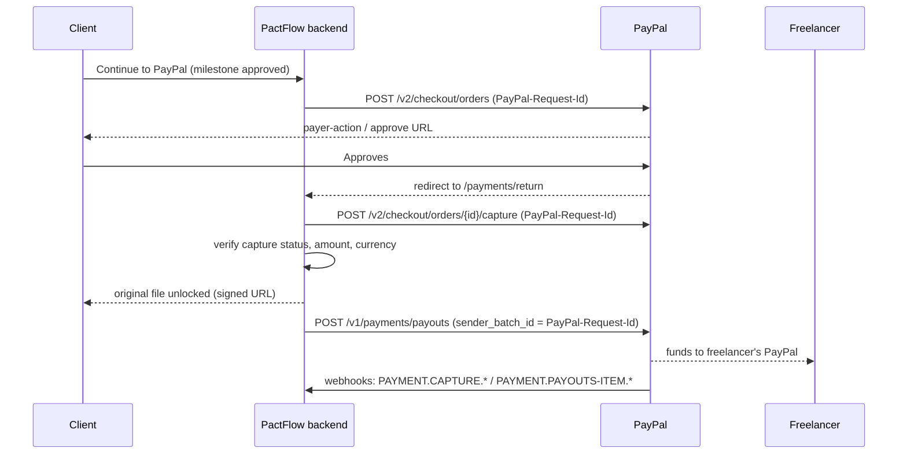

# PactFlow — Product & Technical Guide

PactFlow takes a freelance project from a client's brief to a paid, delivered and
remembered engagement. AI drafts and checks the paperwork; people approve every
decision; PayPal moves the money in both directions; the backend enforces every
state change.

This guide covers **what the product does, which tools it uses, how and where**.
Every feature points at the files that implement it.

- [1. The lifecycle at a glance](#1-the-lifecycle-at-a-glance)
- [2. Features](#2-features)
- [3. How we use PayPal](#3-how-we-use-paypal)
- [4. How we use AI](#4-how-we-use-ai)
- [5. Sponsor technologies](#5-sponsor-technologies)
- [6. Tech stack](#6-tech-stack)
- [7. Security and trust](#7-security-and-trust)
- [8. API map](#8-api-map)
- [9. Testing](#9-testing)
- [10. Running it and the demo script](#10-running-it-and-the-demo-script)
- [11. Honest limitations](#11-honest-limitations)

---

## 1. The lifecycle at a glance

```mermaid
flowchart LR
  A[Brief] --> B[Invite freelancers]
  B --> C[AI-drafted proposals]
  C --> D[Compare<br/>AG Grid]
  D --> E[Select → Engagement]
  E --> F[Discovery chat]
  F --> G[AI-drafted requirements<br/>with sources]
  G --> H[Both approve one version]
  H --> I[SOW with traceability]
  I --> J[Agreement<br/>dual approval]
  J --> K[Milestones<br/>Bryntum Gantt]
  K --> L[PDF delivery<br/>watermarked preview]
  L --> M[PayPal Checkout<br/>Orders v2 capture]
  M --> N[Verified capture →<br/>original file unlocked]
  N --> O[PayPal Payouts<br/>to freelancer]
  J -.-> P[Scope change →<br/>AI check vs BRD + SOW → vote]
  O --> Q[Collaboration history<br/>& repeat work]
```



**The rule behind every step:** *AI proposes, people approve, the backend enforces.*
No AI output changes state by itself; every transition goes through a state table
in [`src/lib/state/index.ts`](../src/lib/state/index.ts) and writes an append-only
audit entry ([`src/lib/audit/index.ts`](../src/lib/audit/index.ts)) in the same
database transaction.

---

## 2. Features

### 2.1 Briefs and invitations

| Feature | What it does | Where |
| --- | --- | --- |
| Structured brief | Title, description, 1–20 deliverables, budget range, target date; `DRAFT → OPEN → CLOSED/CANCELLED`; editable only while a draft. | `src/lib/briefs/`, `src/app/(dashboard)/briefs/` |
| Freelancer invitations | Up to 50 per brief, duplicate guard, re-invite after decline, auto-revoke on close, in-app notifications. | `src/lib/invitations/` |
| Templates & repeat invites | Start a new brief from a past project; re-invite a past freelancer with the collaboration summary attached. | `src/lib/collaboration/`, `src/app/api/invitations/repeat/` |

### 2.2 Proposals (quotations)

| Feature | What it does | Where |
| --- | --- | --- |
| AI quotation draft | Line items, timeline and notes grounded in the brief; falls back to an empty form if the brief is too thin or the AI fails. Up to 3 regenerations. | `src/lib/ai/quotation.ts` |
| AI pricing guidance | Per line item: price range, confidence (LOW/MEDIUM/HIGH) and its basis — brief budget, the freelancer's own history, or a labelled baseline estimate. Never presented as market data. Dismissable; accepting is recorded. | `src/lib/ai/pricing.ts`, `src/lib/ai/heuristic.ts` |
| Original AI values kept | The AI draft is stored next to the freelancer's edits for audit. | `Quotation.aiDraftSnapshot` |
| Comments & clarifications | Threaded comments, 15-minute edit window, clarification requests tracked until answered. | `src/lib/quotations/comments.ts` |
| Live withdrawal notice | The client's open view updates when a freelancer withdraws. | `src/components/quotation-status-watcher.tsx` |

### 2.3 Comparison workspace

| Feature | What it does | Where |
| --- | --- | --- |
| Aligned bid grid (**AG Grid**) | Proposals as columns, attributes as rows (totals, timeline, line items aligned by description), pinned attribute column, quick filter, CSV export. | `src/components/comparison-grid.tsx` |
| AI comparison summary | Key differences, every statement grounded in the proposals shown; "AI comparison unavailable" fallback. | `src/lib/ai/comparison.ts` |
| Private annotations | Client-only cell notes that persist across sessions. | `src/lib/quotations/comparison.ts` |
| PDF export | The workspace as a PDF summary. | same, via `pdf-lib` |
| **Select a proposal** | Opens an **Engagement** — not a contract (see 2.4). | `src/lib/engagements/index.ts → selectProposal` |

### 2.4 Engagement, discovery and the requirements brief (BRD)

Selecting a freelancer is a *selection*, not a signature. The two parties first
agree **what** is being built.

| Feature | What it does | Where |
| --- | --- | --- |
| Engagement | Created on selection, idempotent, one open engagement per brief; cancel to choose again (history kept). States: `DISCOVERY → REQUIREMENTS → REQUIREMENTS_APPROVED → AGREEMENT`. | `src/lib/engagements/index.ts`, `src/app/(dashboard)/engagements/` |
| Discovery thread & terms | Chat that needs no agreement; record whether discovery is unpaid, time-boxed or paid. | same |
| **AI requirements draft** | Drafts objective, functional & non-functional requirements, assumptions, exclusions, constraints and success measures **only** from the brief, the proposal and discovery messages. Every item cites its source (`Brief · deliverables[0]`, `Proposal · lineItems[2]`, `Discovery message`). Citations that don't resolve are dropped and the item flagged *needs confirmation*. The draft is not saved until a person reviews it. | `src/lib/ai/requirements.ts` |
| Versioned BRD | Each save is a new immutable version; stable IDs `REQ-001`, `NFR-001`, `ASM-001` that are never reused; stale-editor protection. | `src/lib/requirements/content.ts` |
| Confirmations | Unconfirmed assumptions or flagged items block approval; confirming records *which party* confirmed (set by the server, not the browser). | same |
| Review comments | Anchored to a version and optionally one requirement ID; resolved explicitly, never deleted. | `src/lib/engagements/index.ts` |
| Mutual approval | Both parties approve **the same version**; approving v1 never approves v2. | `approveRequirements` |
| **SOW** | Built from the approved BRD + the accepted proposal: deliverable → requirement → acceptance-criteria trace table, exclusions, confirmed assumptions, price & timeline, payment terms, change control. Price-vs-budget and timeline-vs-target conflicts must be resolved by a person. Submitting creates Agreement v1. | `src/lib/engagements/sow.ts`, `src/components/sow-view.tsx` |

### 2.5 Agreements and scope changes

| Feature | What it does | Where |
| --- | --- | --- |
| Versioned agreement | Immutable versions, sequential numbers enforced by a DB unique constraint; active only when **both** parties approve the same version. Links back to the requirements version. | `src/lib/agreements/` |
| Scope-change proposals | Raised in the agreement discussion; both parties vote; an approved change creates a new version; disputes, retraction, withdraw, deadlines. | `src/lib/change-requests/` |
| **Evidence-based scope check** | Each change is classified INCLUDED / OUTSIDE_SCOPE / AMBIGUOUS **against the approved BRD and the SOW**, citing the exact `REQ` / `DEL` / `OOS` items and matched terms. Explicit exclusions win. An AI label with no valid citation is downgraded to AMBIGUOUS. Advisory only — the AI never votes. | `src/lib/ai/scope-baseline.ts`, `src/lib/ai/scope-classification.ts` |

### 2.6 Delivery

| Feature | What it does | Where |
| --- | --- | --- |
| Milestone timeline (**Bryntum Gantt**) | Milestones on their due dates, chained in sequence, with payment status; read-only because dates are contractual. | `src/components/milestone-gantt.tsx`, `src/app/(dashboard)/delivery/page.tsx` |
| PDF upload with integrity | SHA-256 of the exact bytes stored at upload and re-checked on every access; versioned uploads. | `src/lib/deliverables/` |
| Watermarked preview | A "PREVIEW" copy is generated with `pdf-lib`; preview and original live under unrelated private keys. | `src/lib/pdf/index.ts`, `src/lib/storage/` |
| Review & revisions | Approve or request revisions within the agreed revision limit; at the limit the app points to a scope change. | `src/lib/deliverables/review.ts` |
| Payment-gated original | The original is only reachable through a signed URL (≤ 60 min) issued after the milestone payment is **verified as captured**. | `src/lib/storage/signed-url.ts`, `src/app/api/files/signed/` |

### 2.7 Relationship intelligence

| Feature | What it does | Where |
| --- | --- | --- |
| Collaboration history | Append-only record of completed projects per client–freelancer pair. | `src/lib/collaboration/` |
| Working preferences | Proposed by one party, confirmed by the other before they count. | same |
| AI collaboration summary | Grounded only in the history, cites its sources, can be flagged by either party. | `src/lib/ai/collaboration.ts` |

### 2.8 Platform

Auth with lockout and password reset, in-app notifications (with guaranteed
retry for payment events), command-palette search, operator audit view,
scheduled jobs (`/api/cron`: overdue milestones, change-request expiry,
review reminders, notification retries, payout refresh).

---

## 3. How we use PayPal

PayPal is the money layer in **both directions**: the client pays in, the
freelancer is paid out, and every step is verified and reconciled.



### 3.1 APIs used

| PayPal API | Used for | Where |
| --- | --- | --- |
| **OAuth 2.0** `POST /v1/oauth2/token` | Client-credentials token, cached until near expiry. | `src/lib/payments/paypal-client.ts → getAccessToken` |
| **Orders v2** `POST /v2/checkout/orders` | One order per milestone, `intent: CAPTURE`, `PAY_NOW`, return/cancel URLs. | `createOrder` |
| **Orders v2** `POST /v2/checkout/orders/{id}/capture` | Capture after approval; `ORDER_ALREADY_CAPTURED` is recovered by reading the order. | `captureOrder` |
| **Orders v2** `GET /v2/checkout/orders/{id}` | Read an order that was already captured. | `getOrder` |
| **Webhooks** `POST /v1/notifications/verify-webhook-signature` | Verifies every Sandbox webhook with PayPal before acting on it. | `src/lib/webhooks/verifier.ts` |
| **Payouts** `POST /v1/payments/payouts` | Sends the freelancer's share after a verified capture. | `createPayout` |
| **Payouts** `GET /v1/payments/payouts/{batch_id}` | Reads the payout item status (refresh, scheduled job). | `getPayoutBatch` |

### 3.2 What makes it correct

- **Idempotency everywhere.** Each payment attempt stores one key; order creation
  sends it as `PayPal-Request-Id`, capture sends a derived key, payouts use the
  `sender_batch_id` as the request id. Retries after a lost response can never
  charge or pay twice. ([`src/lib/payments/index.ts`](../src/lib/payments/index.ts))
- **Capture is verified, not assumed.** The backend reads the *capture object*
  (`purchase_units[0].payments.captures[0]`), not just the order status, and
  requires `COMPLETED` **and** an exact amount **and** currency match
  (`evaluateCapture`). A mismatch moves the payment to `REVIEW_REQUIRED`, alerts
  an operator and keeps the file locked. `PENDING` waits for the webhook.
- **Capture evidence is stored**: capture id, capture status, captured amount and
  currency, raw response.
- **Webhooks are verified, de-duplicated and logged.** Bad signatures never touch
  state; PayPal outages return 503 so PayPal retries; each event id is processed
  once; every delivery is kept in an append-only log.
  ([`src/lib/webhooks/index.ts`](../src/lib/webhooks/index.ts))
- **Two-sided payouts.** After a *verified* capture, the freelancer's share
  (minus an optional `PLATFORM_FEE_PERCENT`) is sent with Payouts. One payout per
  payment; payments under review are never paid out; a payout that succeeded can
  never move back; failures are retried by the freelancer under a new batch id;
  missing payout email → the payout waits and the freelancer is notified.
  ([`src/lib/payouts/index.ts`](../src/lib/payouts/index.ts))

### 3.3 Modes

| `PAYPAL_MODE` | Behaviour |
| --- | --- |
| `mock` (default) | A local simulator returns Orders v2 / Payouts-shaped responses so the whole lifecycle runs offline and in tests. The approve screen is clearly labelled **"PayPal checkout simulator · Mock mode"**. |
| `sandbox` | Real PayPal Sandbox calls. Requires `PAYPAL_CLIENT_ID`, `PAYPAL_CLIENT_SECRET` and `PAYPAL_WEBHOOK_ID`. Without credentials the server logs a loud warning instead of silently pretending. |

**Sandbox setup:** create an app at developer.paypal.com → copy client id/secret →
add a webhook pointing at `https://<your-host>/api/webhooks/paypal` subscribed to
`PAYMENT.CAPTURE.COMPLETED`, `PAYMENT.CAPTURE.DENIED` and `PAYMENT.PAYOUTS-ITEM.*`
→ set `PAYPAL_WEBHOOK_ID`. Use a Sandbox **personal** account email as the
freelancer's payout email; payouts are paid from the Sandbox business account the
captures land in.

**Wording we stand by:** the client's payment is captured to the platform's PayPal
account and the freelancer's share is paid out per milestone once that capture is
verified. PactFlow is not an escrow service.

---

## 4. How we use AI

| AI task | Inputs it may use | Guardrail | Where |
| --- | --- | --- | --- |
| Quotation draft | The brief, the freelancer's past totals | Fallback to empty form; freelancer submits | `src/lib/ai/quotation.ts` |
| Pricing guidance | Brief budget, own history | Labelled basis; never "market rate" | `src/lib/ai/pricing.ts` |
| Comparison summary | Proposals in the workspace | Grounded statements; no ranking | `src/lib/ai/comparison.ts` |
| **Requirements draft** | Brief, accepted proposal, discovery messages | Citations checked against real records; unsourced → *needs confirmation*; never confirms assumptions; reviewed before save | `src/lib/ai/requirements.ts` |
| **Scope classification** | Approved BRD + SOW items | Must cite real item IDs or it is downgraded to AMBIGUOUS; advisory only | `src/lib/ai/scope-baseline.ts` |
| Collaboration summary | Completed-project history | Cites history entries; can be flagged | `src/lib/ai/collaboration.ts` |

**Engine.** Any OpenAI-compatible chat-completions endpoint (`LLM_API_KEY`,
`LLM_BASE_URL`, `LLM_MODEL`; default `gpt-4o-mini`). Every call has a deadline
(20–30 s), JSON output and Zod schema validation
([`src/lib/ai/client.ts`](../src/lib/ai/client.ts)). With no key, a deterministic
rules engine produces the same shapes so the demo and tests are reproducible
offline; the UI says which engine produced a draft.

**What AI can never do:** submit a quotation, set a final price, select a
freelancer, approve requirements or an agreement, vote on a scope change, capture
a payment, release a file or pay anyone.

---

## 5. Sponsor technologies

| Sponsor | Used? | How and where |
| --- | --- | --- |
| **PayPal** (host) | Yes — core | Orders v2, webhooks + signature verification, Payouts. See [§3](#3-how-we-use-paypal). |
| **AG Grid** (`ag-grid-community`, `ag-grid-react` v36) | Yes | The comparison workspace grid: quotations pivoted into columns, pinned attribute column, resizable columns, quick filter search, CSV export, Quartz theme matched to the app's palette. `src/components/comparison-grid.tsx`, loaded client-only from `src/app/(dashboard)/briefs/[briefId]/compare/`. |
| **Bryntum** (`@bryntum/gantt-enterprise` v8) | Yes | The milestone timeline on the Delivery page: milestones as tasks on their due dates, sequential dependencies, payment status per bar, read-only because dates are contractual terms. Stylesheets and icon fonts are served from our own `/api/vendor/bryntum/[asset]` route (fixed allow-list, no CDN). Licence key via `NEXT_PUBLIC_BRYNTUM_LICENSE_KEY`. `src/components/milestone-gantt.tsx`, `src/lib/milestones/schedule.ts`. |
| **Render** | Yes — deployment | `render.yaml` Blueprint: Node 22 web service with a persistent disk for the SQLite database and uploaded files, generated secrets, one-time demo seed, `/login` health check. |
| APIMatic, Channel3, Elastic, KERNEL, Zapier | Not used | Out of scope for this product. |

---

## 6. Tech stack

| Layer | Choice | Notes |
| --- | --- | --- |
| Framework | **Next.js 15** (App Router) + **React 19**, TypeScript | Modular monolith: `src/lib/<domain>` holds all business rules; route handlers stay thin. |
| Data | **Prisma 6** | SQLite locally and on Render; the schema is single-source in `prisma/schema.prisma`. |
| Auth | **Auth.js (next-auth v5)** credentials + **bcrypt** | 24 h JWT session, `SameSite=Strict` cookie, 5 failures in 15 min → 15 min lockout. |
| Validation | **Zod** | Every request body and every AI output. |
| Files | Local disk or **S3-compatible** (`@aws-sdk/client-s3`) | Private keys; HMAC-signed URLs locally, presigned URLs on S3. |
| PDF | **pdf-lib** | Watermarked previews, comparison export. |
| UI | **Tailwind CSS 4**, lucide icons | Accessible forms, light/dark theme. |
| Tests | **Vitest** + **fast-check** (property tests), **Playwright** (E2E) | See [§9](#9-testing). |

---

## 7. Security and trust

- **Access control on every read and write** — participants only; violations are
  logged with actor, resource and time ([`src/lib/access.ts`](../src/lib/access.ts)).
- **Append-only audit log** written in the same transaction as each state change;
  no update/delete path exists.
- **Files:** SHA-256 verified on every access; preview and original under
  unrelated keys; storage keys never reach the browser; signed URLs expire in
  ≤ 60 minutes and are invalidated on role change.
- **Payments:** idempotent, verified captures; mismatches held for review; payouts
  only from verified captures.
- **Webhooks:** PayPal signature verification in Sandbox; the public dev secret is
  refused in production.
- **HTTPS redirect** (308) on public hosts; login redirect preserves the target URL.

---

## 8. API map

| Area | Routes (`src/app/api/…`) |
| --- | --- |
| Auth | `auth/[...nextauth]`, `auth/register`, `auth/forgot-password`, `auth/reset-password` |
| Briefs | `briefs`, `briefs/[id]`, `…/publish`, `…/close`, `briefs/from-template/[templateId]` |
| Invitations | `invitations`, `…/[id]/accept`, `…/[id]/decline`, `…/[id]/attachment`, `invitations/repeat` |
| Quotations | `quotations`, `quotations/ai-draft`, `…/[id]/submit`, `…/withdraw`, `…/shortlist`, `…/regenerate`, `…/pricing`, `…/pricing/dismiss`, `…/comments`, `…/events` |
| Comparison | `briefs/[id]/comparison`, `…/ai-summary`, `…/export`, `…/accept` (→ engagement) |
| Engagements | `engagements`, `engagements/[id]`, `…/messages`, `…/terms`, `…/cancel`, `…/requirements/draft`, `…/requirements/versions`, `…/requirements/approve`, `…/requirements/comments`, `…/comments/[commentId]/resolve`, `…/sow` |
| Agreements | `agreements`, `agreements/[id]`, `…/approve`, `…/versions`, `…/messages`, `…/change-requests` (+ `vote`, `withdraw`, `retract`, `dispute`, `reclassify`) |
| Delivery | `milestones`, `…/deliver`, `…/approve`, `deliverables/[id]` (+ `preview`, `download`, `approve`, `revise`, `history`, `regenerate-preview`), `files/signed` |
| Payments | `payments` (initiate), `payments/capture`, `payments/retry`, `webhooks/paypal` |
| Payouts | `payouts/account`, `payouts/[id]/refresh`, `payouts/[id]/retry` |
| Relationship | `collaboration/…` (history, preferences, summary, flag, templates) |
| Platform | `notifications`, `notifications/poll`, `search`, `audit` (operators), `cron`, `vendor/bryntum/[asset]` |

---

## 9. Testing

| Suite | Command | What it proves |
| --- | --- | --- |
| Unit + property + integration (Vitest, fast-check) | `npm test` | 194 tests: version monotonicity, dual-approval gating, SHA-256 integrity, preview/original key separation, payment-before-delivery, idempotent orders & webhooks, signed-URL expiry, scope-label coverage, change-request serialisation, append-only history; engagement lifecycle (AT-01…AT-08), requirement IDs & provenance, SOW traceability & conflicts, capture verification, payouts (once, never on review, retry, webhooks), evidence-based scope checks. |
| End-to-end (Playwright) | `npm run e2e` | Registration/login, brief → proposals → comparison → engagement → AI requirements → v2 confirmation → both approve → SOW → agreement; delivery → mock payment → signed download; scope-change votes. |
| Types / lint | `npm run typecheck`, `npm run lint` | Clean. |

---

## 10. Running it and the demo script

```bash
npm install
cp .env.example .env
npm run db:reset      # schema + demo data
npm run dev
```

Demo accounts (password `Password123!`): `client@pactflow.dev`,
`freelancer@pactflow.dev` (Ada, has a payout email), `grace@pactflow.dev` (Grace,
no payout email — shows the waiting path).

**3-minute demo path**

1. *Briefs → Compare quotations* — AG Grid alignment and AI summary. **Select** a proposal → an Engagement opens; no agreement exists.
2. Post a discovery message → *Requirements → Draft with AI* — show source badges and a *needs confirmation* item → save v1 (approval blocked).
3. As the freelancer, confirm the items → save v2 → both approve v2.
4. *Review SOW* — the deliverable → requirement trace; submit → Agreement v1 → both approve.
5. *Agreement discussion* — propose a change; show the evidence-backed label (e.g. `OOS-002 explicitly excludes this`).
6. *Delivery* — Bryntum timeline; upload a PDF, open the watermarked preview, approve, pay with PayPal (Sandbox), watch the original unlock and the **Freelancer payout** card show *Paid to Freelancer*.
7. *Collaboration* — history, confirmed preferences, AI summary with citations.

---

## 11. Honest limitations

- The default configuration is mock PayPal and the offline rules engine; a real
  Sandbox and a real LLM need the keys in §3.3 and §4.
- Paid discovery is recorded, not charged.
- Approved scope changes create a new agreement version but do not yet create a
  new requirements version automatically.
- One currency (USD) end to end.
- SQLite is the shipped database; a PostgreSQL deployment needs its datasource
  switched in `prisma/schema.prisma`.
